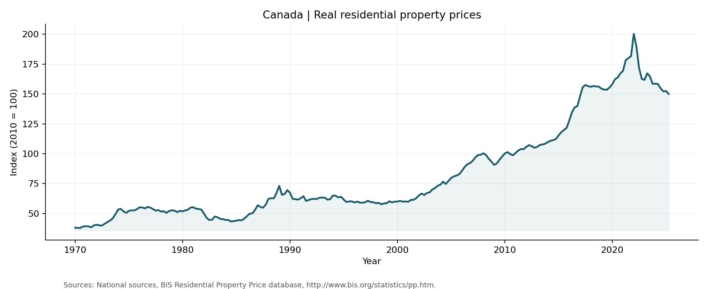

# Canada Housing · SARIMA Forecasting

**From Box–Jenkins diagnostics to manual forecast recursions and chronological evaluation in R.**

  

**En français :** étude des prix réels de l’immobilier résidentiel au Canada, simulation ARIMA, prévision SARIMA manuelle et analyse critique des intervalles de prévision. Projet réalisé par **Naoufal Berquecha et Sarra El Faiez**.

[Approach](#approach) · [Quick start](#quick-start) · [Methodology](docs/methodology.md) · [Data](data/README.md) · [Contributions](AUTHORS.md) · [Related work](docs/related-projects.md)



## Approach

| Stage | Work performed |
|---|---|
| Simulation | ARIMA(p,1,q), burn-in, innovations and drift |
| Identification | Log transformation, differencing, ACF/PACF, stationarity tests |
| Modeling | ARIMA/SARIMA candidates, parameter checks and residual diagnostics |
| Forecasting | Manual recursion, seasonal polynomial composition, comparison with R |
| Evaluation | Added chronological holdout, seasonal naive baseline and log-scale errors |

The academic study discusses **SARIMA(1,1,0)(0,1,1)[4]**. The new entry point compares that fixed structure against `auto.arima()` and seasonal naive using the final eight observed quarters, then produces eight-quarter forecasts from the complete series.

**Execution status:** source and data reviewed; the new R entry point has not been run in this environment because R is unavailable. The chart above contains observed values. No new forecast accuracy is claimed. See [validation details](docs/methodology.md).

## Quick start

Install R (4.3+ recommended) and run these commands **from the repository root**:

```bash
Rscript install.R
Rscript run.R
```

Use a different two-column FRED CSV if needed:

```bash
Rscript run.R path/to/QCAR628BIS.csv
```

The command writes `holdout_metrics.csv`, `forecast_comparison.csv`, `forecast.png`, `run.txt` and `sessionInfo.txt` to `reports/current/`. Forecasts and errors are on the **log-index scale**.

To inspect the complete academic workflow in RStudio, open `analysis/research_workflow.R`. Its assumptions and historical implementation issues are described in [methodology](docs/methodology.md).

## Repository guide

| Path | Purpose |
|---|---|
| `run.R` | Chronological evaluation and forecast export |
| `R/manual_forecast.R` | Reusable educational ARIMA/SARIMA functions |
| `analysis/research_workflow.R` | Original analysis with portability and execution fixes |
| `data/` | Original supplied snapshot and source attribution |
| `reports/` | Historical series chart; generated results after execution |
| `docs/methodology.md` | Statistical assumptions and validation status |

## Authorship and data

**Naoufal Berquecha:** real-series study and additional interval comparison. **Sarra El Faiez:** simulation and manual ARIMA forecasting. See [AUTHORS.md](AUTHORS.md).

Sources: National sources, BIS Residential Property Price database, http://www.bis.org/statistics/pp.htm. Retrieved through [FRED](https://fred.stlouisfed.org/series/QCAR628BIS); the bundled data is the supplied historical snapshot, not a live feed.

[Reuse notice](NOTICE.md)
